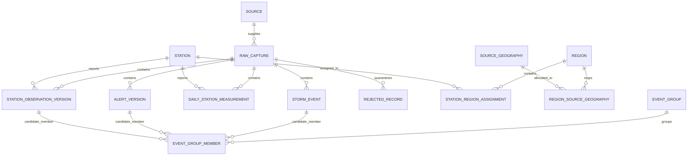

# Workshop 1 - Source Validation and Project Definition

**Team 9 - Multi-Hazard Weather Impact Monitoring**  
**Course:** Data Analysis Programming, 2026-II  
**Status:** English report draft substantially complete for rubric review; final PDF export and visual review intentionally deferred
**Scope:** Workshop 1 source validation and project definition only

> This draft distinguishes observed evidence, official documentation, accepted scope decisions, and still-preliminary designs. Oklahoma/counties and the temporal windows are accepted. The Compound Hazard Index is accepted only as a Workshop 1 proposal, and no cross-source candidate is presented as a confirmed physical-event match.

## 1. Executive summary

The project will investigate a monitoring system that combines historical weather records with current or recently updated observations and alerts. Its purpose is to help a regional analyst understand observed hazards alongside a historical baseline. It is not a hazard-forecasting system and must not replace official warnings.

The repository contains evidence for all four assigned sources. Kevin's NOAA Storm Events and NWS Alerts evidence covers Oklahoma. Pablo's Denver samples remain useful alternative/update-behavior evidence, including one same-ID station revision. Oklahoma City evidence contains 365 GHCN-Daily rows, two 200-feature KOKC polls, and an older 500-feature cursor page. The team accepted Oklahoma/counties because it aligns all four sources and offers a broader hazard mix. Five alert/KOKC rows are retained as unconfirmed investigation candidates. The final production schema and architecture remain open.

## 2. Problem and proposed user

Compound weather impacts can arise when more than one hazard occurs during overlapping or successive periods, or when current conditions occur against a relevant historical context. This proposal focuses on flood, wind, heat, cold, and winter-weather conditions. NOAA Storm Events contributes reported event type, impact fields, and hazard-specific magnitudes (whose units depend on `MAGNITUDE_TYPE`); GHCN-Daily contributes daily PRCP in millimetres and TMAX/TMIN in degrees Celsius in the profiled metric response; NWS station observations contribute measured values with per-property unit codes and quality-control flags; NWS Alerts contribute categorical urgency, severity, certainty, timing, and affected geography rather than a common numeric physical measurement. These quantities must remain source-qualified and must not be added or compared as if they shared one scale. A county-level monitoring view could help an emergency-management analyst review current observations and official alerts against a seasonal baseline, while exposing gaps and provenance; it is monitoring context, not a forecast or replacement for official warnings.

**Proposed functional user:** a county or regional emergency-management analyst who monitors reported weather impacts and needs a traceable view of current source observations relative to a historical baseline. The team should confirm the user with the professor or intended stakeholder before finalizing the report.

## 3. Prioritized user stories (draft)

| Priority | User story | Acceptance evidence for later workshops |
| --- | --- | --- |
| Must | As an emergency-management analyst, I want to see recent observations, alerts, and reported events for an approved region so that I can review current conditions. | Map/list shows source and observation/issue time; empty source responses are visible as empty, not errors. |
| Must | As an analyst, I want to compare current measurements with a documented historical baseline so that unusual conditions can be assessed in context. | Time window, units, baseline period, and exclusions are visible beside each comparison. |
| Must | As a reviewer, I want each displayed record linked to its source, raw evidence, and retrieval time so that I can trace how it entered the system. | Source identifier, raw reference/hash, and ingestion timestamp are available on drill-down. |
| Should | As an analyst, I want to filter by hazard type, time interval, and geographic unit so that I can focus review on a local situation. | Filters update map and time-series views consistently and preserve the chosen interval. |
| Should | As an analyst, I want to see missingness, freshness, and rejected-record counts so that I can distinguish an uneventful period from incomplete data. | A data-health panel reports per-source last success, watermark, null/invalid counts, and active limitations. |
| Could | As an analyst, I want to export a filtered evidence table so that I can include source references in a briefing. | Export retains units, source IDs, timestamps, and provenance fields. |
| Won't (Workshop 1-4) | As a user, I will not treat the dashboard as a predictor of future hazards or as an official alerting service. | Product copy and report state monitoring/correlation purpose and defer warnings to official NWS products. |

These stories remain product proposals. The team has accepted Oklahoma/counties, the 2010-2025 baseline and the rolling 24-hour current window; the functional user and final validated indicator behavior still require stakeholder/implementation review.

## 4. Source validation evidence

| Source | Evidence captured | Profile facts | Limitation |
| --- | --- | --- | --- |
| NOAA Storm Events (Kevin) | Accepted Oklahoma study area; 2024 official archive with a deterministic derived 250-row sample; 51 columns. | 250 distinct event IDs; event and geography distributions are in the NOAA source notes and notebook. The archive query yielded 2,317 rows for the selected event-family filter, of which 1,681 use zone geography and lack begin coordinates. | Oklahoma scope is accepted; a zone record without a point needs a zone/county crosswalk, and one year does not establish statewide historical completeness. |
| GHCN-Daily/NCEI (Pablo/Kevin) | Preferred-region station `USW00013967`, 2025, daily summaries CSV; 365 rows, 12 columns. Denver station `USW00003017` is retained as alternative evidence. | Oklahoma City has 365 unique dates, no duplicate station-date keys, and no null requested values. PRCP contains 41 trace flags (`T`) paired with numeric `0.0`. | One Oklahoma City station/year does not establish statewide coverage or historical volume. |
| NWS Alerts (Kevin) | Oklahoma active polls (0 features each) plus complete observed recent-window pages (238 features). | 238 unique alert IDs; 42 null geometries (all have affected zones); 42 null `ends`; 79 null instructions. Update/cancel messages occur in the recent sample. | Empty active polls do not demonstrate alert-level changes; recent window is not a long-term archive. |
| NWS station observations (Pablo/Kevin) | KDEN and preferred-region KOKC each have two bounded first pages of 200 features. | KDEN: 96 shared IDs, 95 unchanged and one same-ID revision. KOKC: 197 shared IDs, all unchanged; three IDs entered and three left the rolling page. | Absence from a later bounded page is not a deletion. Four captures at two stations do not establish a service-wide revision policy or statewide coverage. |

The evidence files, retrieval metadata, and checksums are indexed in [`EVIDENCE_REGISTER.md`](EVIDENCE_REGISTER.md). Detailed Pablo source research is in [`source-research-ghcn-nws-stations.md`](source-research-ghcn-nws-stations.md). Kevin's source documentation is in [`docs/sources/noaa-storm-events.md`](../../docs/sources/noaa-storm-events.md) and [`docs/sources/nws-alerts.md`](../../docs/sources/nws-alerts.md).

### 4.1 Region comparison and recommendation

The same 14-family filter applied to the official 2024 Storm Events archive
produced 2,317 Oklahoma rows across all 14 selected event types, compared with
1,350 Colorado rows across 11 types and only 21 Denver-name rows across six
types. Oklahoma included substantial heat, convective wind, flood, cold, high
wind, and winter evidence; the Colorado screen was more strongly concentrated
in snow, winter weather, thunderstorm wind, and high wind.

Both candidates have a qualifying 365-row single-station GHCN sample and
two-poll 200-feature NWS station evidence. Oklahoma additionally aligns with
the registered NWS Alerts evidence, including 238 recent features. The recommendation is
therefore **Oklahoma as the study area and counties as the primary analytical
unit**, with forecast zones and polygons retained for explicit crosswalking.
The team accepted this scope on 2026-11-05. Exact counts, checksums, methodology, and limitations are in
[`region-comparison-oklahoma-vs-denver.md`](../../docs/reports/region-comparison-oklahoma-vs-denver.md).

### 4.2 Accepted temporal scope

The historical baseline is `2010-01-01` through `2025-12-31`, using complete
calendar years and annual source partitions. Current conditions are the rolling
24 hours ending at an hourly UTC boundary. A separate seven-day context supports
audit, late-arrival recovery and trends but does not automatically enter the
24-hour CHI. The initial seasonal comparison uses the same calendar month
across baseline years. ADR 0003 records rationale and alternatives.

## 5. Data-quality observations and handling proposals

These are sample observations and interpretation questions, not a claim that each is a source defect.

1. **GHCN trace precipitation:** 41 of 365 Oklahoma City PRCP records have measurement flag `T` while the numeric value is `0.0`. Preserve the measurement flag; do not silently equate trace precipitation with an ordinary measured zero.
2. **KOKC 24-hour maximum/minimum temperature availability:** both fields are null in all 200 first-page observations. This is an observed availability limitation; the captured evidence does not establish its cause, and missing values must not be interpreted as ordinary temperatures.
3. **Station observation payload revision:** one of 96 overlapping KDEN feature IDs kept the same ID and timestamp but changed values, QC fields, and cloud metadata between captures. Compare content hashes as well as identifiers; retain versions/raw responses. The absence of such a change among 197 KOKC shared IDs does not remove this requirement.
4. **KOKC precipitation availability:** `precipitationLastHour` and `precipitationLast3Hours` contain no numeric values in the captured first page. Preserve nulls and QC metadata; do not infer zero rainfall from missing numeric values.
5. **KOKC station cadence variation:** 119 of 199 adjacent timestamp intervals are not exactly five minutes; observed intervals range from two to 63 minutes. Preserve source time and avoid assuming a fixed schedule.
6. **NWS alert geometry:** 42 of 238 recent alerts have null polygons but provide affected zones. Use affected zones/geocodes before treating geography as absent.
7. **NOAA point geography:** 1,681 of 2,317 filtered archive rows use zone geography and have missing begin coordinates. Resolve location using documented zone/county fields; do not invent point coordinates.

The following concrete rows make the observations reproducible. “Quality problem” here includes source limitations and revision/availability behavior; it does not imply that the provider violated its own contract. Raw sample paths and stable source identifiers are shown so each case can be inspected.

| Example | Source record / capture | Observed evidence | Interpretation and handling |
| --- | --- | --- | --- |
| Q-01 | GHCN-Daily `USW00013967`, `2025-01-05`, `workshop_1/samples/region_comparison/ghcn_okc_usw00013967_2025.csv` | `PRCP=0.0`; `PRCP_ATTRIBUTES=T,,W,2400` | Trace precipitation is encoded with numeric zero; retain the flag and do not interpret it as an ordinary measured zero. |
| Q-02 | NOAA Storm Events `EVENT_ID=1155350`, `workshop_1/samples/noaa_storm_events/details_sample.csv` | Heavy Snow, `CZ_TYPE=Z`, `CZ_NAME=CIMARRON`; `BEGIN_LAT` and `BEGIN_LON` are blank | The source geography is a zone with no point coordinate in this row; keep the zone and missing point rather than fabricate a location. |
| Q-03 | NWS alert `urn:oid:2.49.0.1.840.0.86cd7f91116ab184a79b0a23e06189d945720161.001.1`, `workshop_1/samples/nws_alerts/recent_7d_page_1.geojson` | Wind Advisory; null GeoJSON geometry; `affectedZones` contains seven zone URLs | Null polygon does not mean unknown geography; preserve affected zones and do not silently drop the alert. |
| Q-04 | NWS KDEN observation `https://api.weather.gov/stations/KDEN/observations/2026-11-04T01:53:00+00:00`, compared in `nws_kden_observations_poll1.geojson` and `nws_kden_observations_poll2.geojson` | Same feature ID and timestamp; temperature changed from null/QC `Z` to `4.4 degC`/QC `V` | A stable ID can carry a changed payload. Retain versions or revision history and compare content hashes; cause is not established. |
| Q-05 | NWS KOKC observations `https://api.weather.gov/stations/KOKC/observations/2026-11-03T21:52:00+00:00` and `https://api.weather.gov/stations/KOKC/observations/2026-11-03T22:55:00+00:00`, `workshop_1/samples/region_comparison/nws_kokc_observations_snapshot.geojson` | Adjacent returned timestamps are 63 minutes apart, not five | The bounded feed does not provide a guaranteed five-minute record cadence in this sample; preserve source timestamps and avoid synthesizing missing observations. |
| Q-06 | NWS KOKC observation `https://api.weather.gov/stations/KOKC/observations/2026-11-03T21:52:00+00:00`, same snapshot | `maxTemperatureLast24Hours` and `minTemperatureLast24Hours` are null | Optional field unavailability is not zero; represent as unavailable and disclose scope/field limitation. |

These five required examples are Q-01 through Q-05; Q-06 is an additional availability example. Counts and ranges remain sample-level findings, not statewide rates.

### 5.1 Cross-source candidate-pair investigation

Five NWS Alert/KOKC pairs meet a reproducible candidate rule: the alert names
Oklahoma County, a unique KOKC observation falls inside its effective/expiry
interval, and the observation is the earliest unused record at or after the
alert effective time.

| Pair | Alert | Message | Station delay | KOKC description | Selected measurements |
| --- | --- | --- | ---: | --- | --- |
| PAIR-01 | Dense Fog Advisory, Moderate | Alert | 60 s | Fog | Wind 0 km/h; visibility 804.67 m |
| PAIR-02 | Special Weather Statement, Moderate | Alert | 240 s | Light Drizzle | Wind 25.92 km/h; gust 44.64 km/h; visibility 16,090 m |
| PAIR-03 | Severe Thunderstorm Warning, Severe | Alert | 660 s | Thunderstorms and Rain and Fog/Mist | Wind 29.52 km/h; gust 46.44 km/h; visibility 2,010 m |
| PAIR-04 | Severe Thunderstorm Warning, Severe | Update | 660 s | Rain and Fog | Wind 16.668 km/h; visibility 804.67 m |
| PAIR-05 | Severe Thunderstorm Warning, Severe | Update | 480 s | Thunderstorms and Rain and Fog/Mist | Wind 18.36 km/h; gust 46.44 km/h; visibility 1,210 m |

These are candidates, not confirmed same-event matches. A station is one point
and does not represent an entire alert polygon/county. Three warning rows are
messages from the same broader severe-weather episode rather than independent
meteorological events. The exact IDs, units, timestamps, basis, and status are
in `workshop_1/samples/candidate_pairs/nws_alerts_kokc_candidate_pairs.csv`;
the source page and deterministic script are preserved for reproduction.

## 6. Preliminary source-to-model mapping

The mapping in the notebook is a working proposal, not an approved canonical schema.

| Source record | Proposed source-specific entity | Candidate identity | Temporal/geographic handling |
| --- | --- | --- | --- |
| NOAA Storm Events | `storm_event` with hazard-specific attributes | `EVENT_ID` plus source archive/revision reference | Preserve local-time source fields and `CZ_TIMEZONE`; use point coordinates only when present, otherwise retain zone/county location. |
| NWS Alerts | `alert_version` and affected-area relations | Feature ID / `properties.id`; full feature hash for changed versions | Parse RFC 3339 timestamps to UTC; keep polygon, affected zones, and UGC geocodes separately. |
| GHCN-Daily | `daily_station_measurement` | `(STATION, DATE, element)` | Store date as a daily observation date, not a fabricated instant; retain original units/attributes and station metadata snapshot. |
| NWS Station Observations | `station_observation_version` with property/value/unit/QC rows | Station ID + observation feature ID; full feature hash for changed versions | Parse source timestamp to UTC; retain retrieval time; retain per-observation geometry and provider metadata when available. |

### Accepted conceptual ER model

A station is a measurement location, not a hazard footprint. Station membership
uses an effective-dated station-to-region relation. Storm Events retain source
zones/counties, and alerts retain polygons/geocodes; neither substitutes a
station coordinate for an impact area.



The complete conceptual model, entity fields, modeling rules and SQL-level open
questions are in
[`docs/architecture/workshop-1-er-model.md`](../../docs/architecture/workshop-1-er-model.md).
It is accepted for Workshop 1 design and is not an implemented database schema.

## 7. Source contracts and attribution

The following contracts are proposals for review and later implementation, mirrored in `config/sources.yaml`. The sample evidence does not establish service-wide schedules, revision guarantees, or deletion semantics. All four sources use raw-first processing: preserve the response/file and checksum, parse into a staging run, atomically commit accepted records, quarantines, run status, and checkpoint, and only then advance state. On failure, retain the raw evidence, leave the checkpoint unchanged, and retry the same partition/window idempotently.

### NOAA Storm Events - draft

- Historical path: official yearly compressed CSV archive, one archive-year partition at a time; `BEGIN_YEARMONTH` is a row-level date attribute for queries, not the archive partition key. Retain the exact archive filename, retrieval timestamp, checksum and archive creation date. Re-fetch/compare a partition when a republished creation date or checksum changes.
- Profiled row key: `EVENT_ID` for the details table, namespaced by source/archive year; validate uniqueness in other related tables before using the key there.
- Resume: commit one complete year only after parse/validation/quarantine and run metadata are committed; after interruption, retry that year and deduplicate by key plus content hash.
- Volume screen: the 2024 Oklahoma 14-family filter returned 2,317 rows. A simple 16-year linear screen is 37,072 filtered detail rows for 2010-2025. Scaling the 276,358-byte 250-row derived sample by row count gives roughly 41.0 MB of uncompressed CSV as a coarse planning screen only; row widths, annual distribution, archive compression and later revisions can change the actual volume. Recount each year before implementation.
- Attribution: cite NOAA/NCEI Storm Events and the precise archive/version/date and filter; retain the bulk CSV field specification and database guide references in the final bibliography. No separate dataset license has been established by the reviewed evidence; do not assert one.

### NWS Alerts - draft

- Poll `/alerts/active?area=OK` at a proposed hourly interval, honoring the documented NWS recommendation of no more than one request every 30 seconds and using an identifying User-Agent. Preserve status, retrieval time, relevant validators and body checksum. Hourly is a project proposal, not a source requirement.
- Key: `properties.id` (cross-check the feature `id`); compare full-feature content hashes to detect changes. This is a full active-state snapshot, so there is no record-level watermark; preserve `sent` and `effective` as source timestamps. The two active polls were empty, so alert-level revision/deletion behavior was not empirically observed. Do not infer deletion merely from absence; distinguish expiry/cancellation using source semantics and retain the raw poll.
- Use a small overlap by reprocessing the complete active response each poll; it is a current-state collection, not a resumable historical watermark. Commit response-derived changes before recording successful poll state. Recovery is a fresh full active poll; do not rely on the seven-day recent-alert endpoint as a durable archive.
- Recent sample is the observed seven-day endpoint window with 238 features; retain `sent`, `effective`, `onset`, `ends`, and `expires` separately. Cite NWS API documentation and its use/disclaimer terms; preserve provenance and do not imply NWS endorsement.

### GHCN-Daily/NCEI - draft

- Partition the raw daily-summary CSV by selected station and calendar year. The raw wide-row duplicate key is `(STATION, DATE)`; after reshaping, the normalized measurement key is `(STATION, DATE, element_code)`. `DATE` is a partition attribute, not a monotonically advancing ingestion watermark for this historical backfill.
- Volume screen: the Oklahoma City station sample contains 365 rows for 2025. A straight-line 16-year single-station screen is 5,840 rows and about 0.88 MB using the observed 54,843-byte 2025 response, if all dates are returned each year. It is not an estimate of Oklahoma-wide coverage or missingness. Count selected stations and query each station-year before implementation.
- Keep the profiled daily-summary CSV representation; do not mix it with `.dly` files without an explicit transformation and separate profile.
- Preserve raw response bytes and checksum before parsing. Commit values, rejected rows, raw reference, and run status atomically for each station-year partition.
- Candidate key: `(station_id, observation_date, element_code)`. Preserve measurement, quality, and source flags. Treat repeated key with changed value/flags as a revision.
- NCEI states GHCNd updates daily, reconstructs the archive weekly, and may replace U.S. real-time streams with archive-quality sources typically 45-60 days after month end. Keep an auditable content/version comparison; do not assume the historical partition is immutable.
- Cite GHCN-Daily Version 3 as requested by NCEI, include the subset and access date, and cite the associated Menne et al. database overview in a formal report. NCEI metadata states electronic downloads are generally free and provides use/distribution liability language; it does not identify a separate license on the dataset page.

### NWS Station Observations - draft

- Poll each selected station hourly. Request a one-hour overlap before the last successful observation timestamp; this exceeds the documented up-to-20-minute arrival delay. Reconcile the full available seven-day window daily to detect same-ID revisions missed by the short overlap; both values are proposals constrained by documented retention, and request cost/parameters need testing.
- Identify candidate stations from the approved region using the NWS `/points` station list, then record station/provider metadata and the selection rule.
- Preserve the complete bounded GeoJSON response and retrieval metadata before parsing. Follow pagination until the requested overlap boundary is reached; retain a cursor/page boundary and do not treat page absence as deletion.
- Candidate identity is station ID + feature ID. Compute a deterministic full-feature hash so same-ID payload changes are detected; retain prior payload versions. Do not infer deletion from absence in a later page.
- Preserve measurement value, unit code, quality control, feature timestamp, retrieval timestamp, and geometry. Do not impute nulls silently. NWS currently documents observations that may arrive up to 20 minutes late and a known MADIS issue for 24-hour max/min temperature fields outside the Central time zone.
- Cite the NWS API and use its identifying `User-Agent`. NWS states its API data are open and free to use; its disclaimer says web data are public domain unless specifically annotated, prohibits implying NWS endorsement, and does not grant rights to separately licensed third-party provider data.

## 8. Preliminary Compound Hazard Index proposal

The proposed CHI is a county-level monitoring summary on a `[0, 100]` scale,
not a forecast or official warning. Its five candidate components are flood,
wind, heat, cold, and winter weather. Each component is normalized to `[0, 1]`
against a seasonal historical baseline where the source supports it.

With component scores `s_h`, non-negative weights `w_h` summing to one, and a
bounded interaction term for reviewed pairs:

```text
B = sum(w_h * s_h)
P = max(min(s_i, s_j)) for each configured interaction pair (i, j)
CHI = 100 * min(1, B + beta * P)
```

The review configuration uses equal `0.20` component weights and candidate
`beta = 0.20`. These values are neutral starting parameters, not validated
importance. No interpretation bands are assigned yet.

Missing or stale data never becomes a zero score. If a required component
cannot be evaluated, the total is suppressed and displayed as incomplete;
source health and coverage are reported separately. Coverage is not multiplied
into the index because an outage must not look like reduced hazard.

The complete component definitions, alternatives, versioning requirements,
historical/current comparison, validation plan, and acceptance gate are in
[`ADR 0002`](../../docs/decisions/0002-compound-hazard-index-proposal.md).
Implementation belongs to Workshop 4; Workshop 1 only proposes the design.

## 9. Risks, exclusions, and limitations

| Risk | Mitigation |
| --- | --- |
| One Oklahoma City pilot station could be mistaken for statewide coverage. | Apply ADR 0004's completeness-based multi-station inventory and expose counties with insufficient station coverage. |
| Station readings can be stale, delayed, revised, or missing. | Expose retrieval and observation time, QC, freshness, raw hash, and source-specific update history; avoid silent imputation. |
| Historical daily values can be revised during archive reconstruction. | Re-fetch versioned partitions when appropriate, retain checksums and content hashes, and update only after an auditable commit. |
| Incompatible spatial units (points, zones, counties, alert polygons) can create false event matches. | Retain original geography and use a documented crosswalk; report uncertainty instead of forcing joins. |
| Sparse, optional, or provider-dependent elements can look like data-quality failure. | Interpret nulls against source documentation, provider, element, and QC status; report availability separately from defects. |
| A preliminary combined indicator may imply unsupported precision or prediction. | Keep the index proposal separate from source measurements, document units/normalization, and label it exploratory until validated. |

**Workshop 1 exclusions:** production ingestion, database/Docker/orchestration, final index implementation, automated event matching, prediction, and a production dashboard. Those belong to later workshops. Workshop 1 can draft contracts and interface requirements only.

## 10. Remaining shared decisions and report completion gate

- Apply the accepted Oklahoma/counties and 2010-2025/24-hour decisions consistently in the final model and diagrams.
- Retain the five alert/KOKC rows as `candidate_not_confirmed` unless stronger spatial/event evidence is added.
- Preserve the joint workstream review in `PABLO_REVIEW.md`; repeat mutual review for final schema, architecture and submission commit.
- Agree canonical source/domain tables, alert/zone and station crosswalks, index input proposal, architecture, and report claims.
- Notebook execution was inspected: 29/29 code cells have execution counts 1-29 and no error outputs; eleven evidence checksum assertions are stored. Align this count wherever the current notebook is described.
- Export this English report to PDF and visually review it before submission (intentionally deferred in the current work request).

## 11. Requirement-to-evidence traceability (PDF export remains pending)

| Workshop requirement | Report section / artifact | Evidence and status |
| --- | --- | --- |
| Hazard, severity measures/units, monitoring value | Sections 2, 8 | Source-qualified measures described; index remains proposal. |
| Two historical + two periodic sources; scope and region/time rationale | Sections 3-4; ADRs 0001/0003 | Four profiled sources, Oklahoma decision; region evidence in report. |
| Source access/profile and >=200 records or full smaller response | Section 4; notebook | NOAA 250; GHCN 365; NWS Alerts 238; NWS observations 200 per poll; notebook outputs and evidence register. |
| Two polls >=1 hour apart for periodic sources | Section 4; Evidence Register | Alerts and station comparisons documented; empty alert polls limit field-change evidence. |
| Nulls, ranges, duplicates, timestamp/timezone, coordinates, units | Notebook and source notes | Executed notebook contains profiles; report summarizes material limitations. |
| At least five concrete quality examples | Section 5, Q-01 to Q-05 | Exact source IDs/paths now included; interpretation distinguishes provider behavior from defects. |
| At least five candidate same-event pairs and differences | Section 5.1; candidate-pair CSV | Five temporal/textual-geographic candidates; positions not geometrically tested and no match confirmed. |
| Canonical fields, units, UTC/WGS84, domain entities, ER | Section 6; `workshop_1/mapping.md`; ER diagram | Draft model with explicit open decisions. |
| Historical/incremental contracts, keys, partitions, failure recovery | Section 7; `config/sources.yaml` | Four source proposals described; schedules/volumes remain subject to review and later implementation. |
| Functional user, >=6 MoSCoW stories, indicator proposal, >=5 risks | Sections 2-3, 8-9; ADR 0002 | Included; stakeholder validation and CHI empirical validation deferred. |
| Architecture, repository structure, raw samples, notebook | architecture overview; repo scaffold; notebook; evidence register | Present; outputs are stored and raw samples checksum-indexed. |
| Final English PDF and visual inspection | Not yet produced | Explicitly deferred at Pablo’s request; this is the remaining submission artifact. |

## 12. References

- NOAA NCEI. [Storm Events Database](https://www.ncei.noaa.gov/access/storm-events-database/), [bulk CSV archive and README](https://www.ncei.noaa.gov/pub/data/swdi/stormevents/csvfiles/), and [bulk field specification](https://www.ncei.noaa.gov/pub/data/swdi/stormevents/csvfiles/Storm-Data-Bulk-csv-Format.pdf). Cite the archive/version, retrieval date, and derived filter; the reviewed material did not establish a separate dataset license.
- National Weather Service. [Alerts web service documentation](https://www.weather.gov/documentation/services-web-alerts). Preserve source attribution and do not imply agency endorsement.
- NOAA NCEI. [GHCN-Daily Version 3 dataset metadata and citation](https://www.ncei.noaa.gov/access/metadata/landing-page/bin/iso?id=gov.noaa.ncdc%3AC00861).
- NOAA NCEI. [GHCN-Daily product page, updates, source data and limitations](https://www.ncei.noaa.gov/products/land-based-station/global-historical-climatology-network-daily).
- National Weather Service. [API documentation: access, User-Agent, station observations, retention and upstream issues](https://www.weather.gov/documentation/services-web-api).
- National Weather Service. [Disclaimer and use of public-domain NWS information](https://www.weather.gov/disclaimer).
- NOAA NCEI. [GHCN-Daily README](https://www.ncei.noaa.gov/pub/data/ghcn/daily/readme.txt).
- NOAA NCEI. [Access Data Service documentation](https://www.ncei.noaa.gov/support/access-data-service-api-user-documentation).
