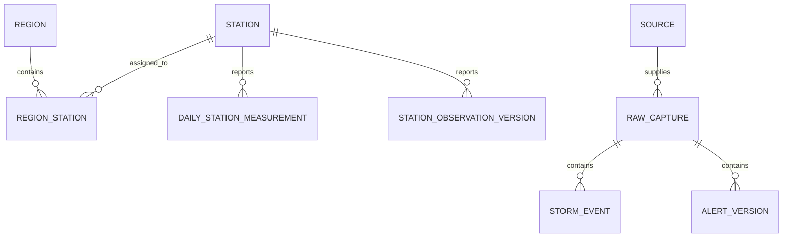

# Workshop 1 - Source Validation and Project Definition

**Team 9 - Multi-Hazard Weather Impact Monitoring**  
**Course:** Data Analysis Programming, 2026-II  
**Status:** Working draft for review; not ready for PDF export or submission  
**Scope:** Workshop 1 source validation and project definition only

> This draft distinguishes observed evidence, official documentation, and team proposals. Oklahoma/counties is now the evidence-backed preferred scope, but it is not accepted until Pablo reviews it. No Compound Hazard Index or cross-source event match is presented as validated.

## 1. Executive summary

The project will investigate a monitoring system that combines historical weather records with current or recently updated observations and alerts. Its purpose is to help a regional analyst understand observed hazards alongside a historical baseline. It is not a hazard-forecasting system and must not replace official warnings.

The repository contains evidence for all four assigned sources. Kevin's NOAA Storm Events and NWS Alerts evidence covers Oklahoma. Pablo's qualifying Denver samples contain 365 GHCN-Daily rows and two 200-feature NWS station pages; one same-ID observation changed between the pages. A separate Oklahoma City coverage check now contains 365 GHCN-Daily rows and 200 KOKC observations. The one-year comparison favors Oklahoma over Denver because it aligns all four source families and offers a broader hazard mix. Pablo's approval and cross-source event overlap remain open, so the scope is preferred rather than accepted and the final data contract remains open.

## 2. Problem and proposed user

Compound weather impacts can arise when more than one hazard occurs during overlapping or successive periods, or when current conditions occur against a relevant historical context. A monitoring view can help a public-sector emergency-management analyst compare observed rainfall, temperature extremes, storm reports, alerts, and station measurements. That use depends on exposing timestamps, geography, units, data gaps, and source provenance so the analyst can judge the evidence.

**Proposed functional user:** a county or regional emergency-management analyst who monitors reported weather impacts and needs a traceable view of current source observations relative to a historical baseline. The team should confirm the user with the professor or intended stakeholder before finalizing the report.

## 3. Prioritized user stories (draft)

| Priority | User story | Acceptance evidence for later workshops |
| --- | --- | --- |
| Must | As an emergency-management analyst, I want to see recent observations, alerts, and reported events for an approved region so that I can review current conditions. | Map/list shows source and observation/issue time; empty source responses are visible as empty, not errors. |
| Must | As an analyst, I want to compare current measurements with a documented historical baseline so that unusual conditions can be assessed in context. | Time window, units, baseline period, and exclusions are visible beside each comparison. |
| Must | As a reviewer, I want each displayed record linked to its source, raw evidence, and retrieval time so that I can trace how it entered the system. | Source identifier, raw reference/hash, and ingestion timestamp are available on drill-down. |
| Should | As an analyst, I want to filter by hazard type, time interval, and geographic unit so that I can focus review on a local situation. | Filters update map and time-series views consistently and preserve the chosen interval. |
| Should | As an analyst, I want to see missingness, freshness, and rejected-record counts so that I can distinguish an uneventful period from incomplete data. | A data-health panel reports per-source last success, watermark, null/invalid counts, and active limitations. |
| Could | As an analyst, I want to export a filtered evidence table so that I can include source references in a briefing. | Export retains units, source IDs, timestamps, and provenance fields. |
| Won't (Workshop 1-4) | As a user, I will not treat the dashboard as a predictor of future hazards or as an official alerting service. | Product copy and report state monitoring/correlation purpose and defer warnings to official NWS products. |

These stories describe a proposal. Region, user confirmation, historical window, current-condition window, and final indicator design require team review.

## 4. Source validation evidence

| Source | Evidence captured | Profile facts | Limitation |
| --- | --- | --- | --- |
| NOAA Storm Events (Kevin) | Oklahoma candidate; 2024 official archive with a deterministic derived 250-row sample; 51 columns. | 250 distinct event IDs; event and geography distributions are in the NOAA source notes and notebook. The archive query yielded 2,317 rows for the selected event-family filter, of which 1,681 use zone geography and lack begin coordinates. | Oklahoma is not approved; a zone record without a point needs a zone/county crosswalk. |
| GHCN-Daily/NCEI (Pablo) | Station `USW00003017`, 2025, daily summaries CSV; 365 rows, 12 columns. | One station and 365 unique dates; no duplicate station-date keys; requested measures have no nulls. PRCP contains 47 trace flags (`T`) paired with numeric `0.0`. | One station/year does not establish regional coverage or historical volume. |
| NWS Alerts (Kevin) | Oklahoma active polls (0 features each) plus complete observed recent-window pages (238 features). | 238 unique alert IDs; 42 null geometries (all have affected zones); 42 null `ends`; 79 null instructions. Update/cancel messages occur in the recent sample. | Empty active polls do not demonstrate alert-level changes; recent window is not a long-term archive. |
| NWS station observations (Pablo) | KDEN first pages, `limit=200`, on two dates separated by 80,124.882 seconds. Each response contains 200 features and `pagination.next`. | 200 unique observation IDs per page; 96 IDs overlap; 95 overlapping payloads are unchanged and one same-ID/same-timestamp payload changed. Units and missingness are profiled in the source note/notebook. | Bounded pages roll forward; absence from the later page is not a deletion. Two polls do not establish a general revision policy. |

The evidence files, retrieval metadata, and checksums are indexed in [`EVIDENCE_REGISTER.md`](EVIDENCE_REGISTER.md). Detailed Pablo source research is in [`source-research-ghcn-nws-stations.md`](source-research-ghcn-nws-stations.md). Kevin's source documentation is in [`docs/sources/noaa-storm-events.md`](../../docs/sources/noaa-storm-events.md) and [`docs/sources/nws-alerts.md`](../../docs/sources/nws-alerts.md).

### 4.1 Region comparison and recommendation

The same 14-family filter applied to the official 2024 Storm Events archive
produced 2,317 Oklahoma rows across all 14 selected event types, compared with
1,350 Colorado rows across 11 types and only 21 Denver-name rows across six
types. Oklahoma included substantial heat, convective wind, flood, cold, high
wind, and winter evidence; the Colorado screen was more strongly concentrated
in snow, winter weather, thunderstorm wind, and high wind.

Both candidates have a qualifying 365-row single-station GHCN sample and a
200-feature NWS station page. Oklahoma additionally aligns with the registered
NWS Alerts evidence, including 238 recent features. The recommendation is
therefore **Oklahoma as the study area and counties as the primary analytical
unit**, with forecast zones and polygons retained for explicit crosswalking.
Pablo must approve this recommendation before ADR 0001 becomes accepted. Exact
counts, checksums, methodology, and limitations are in
[`region-comparison-oklahoma-vs-denver.md`](../../docs/reports/region-comparison-oklahoma-vs-denver.md).

## 5. Data-quality observations and handling proposals

These are sample observations and interpretation questions, not a claim that each is a source defect.

1. **GHCN trace precipitation:** 47 of 365 PRCP records have measurement flag `T` while the numeric value is `0.0`. Preserve the measurement flag; do not silently equate trace precipitation with an ordinary measured zero.
2. **KDEN 24-hour maximum/minimum temperature availability:** both fields are null in all 200 first-page observations. NWS documentation currently identifies an upstream MADIS issue for these fields at stations outside the Central time zone. This is an evidence-backed availability limitation consistent with the published issue, not proof of the cause for each row.
3. **Station observation payload revision:** one of 96 overlapping feature IDs kept the same ID and timestamp but changed values, QC fields, and cloud metadata between captures. Compare content hashes as well as identifiers; retain versions/raw responses.
4. **Station coordinate variation:** the KDEN observation page contains two coordinate pairs for the same station identifier. Check station/provider metadata and preserve the geometry per observation before assigning a fixed station point or region.
5. **Station cadence variation:** 120 of 199 adjacent timestamp intervals in the first page are not exactly five minutes; observed intervals ranged from one to 67 minutes. Preserve source time and avoid assuming a fixed five-minute schedule.
6. **NWS alert geometry:** 42 of 238 recent alerts have null polygons but provide affected zones. Use affected zones/geocodes before treating geography as absent.
7. **NOAA point geography:** 1,681 of 2,317 filtered archive rows use zone geography and have missing begin coordinates. Resolve location using documented zone/county fields; do not invent point coordinates.

The five cross-source event-pair investigation is a shared requirement and remains open. The current evidence is not enough to declare any same-event match. Do not pair a Storm Event, alert, and station reading based only on nearby dates or a shared hazard label.

## 6. Preliminary source-to-model mapping

The mapping in the notebook is a working proposal, not an approved canonical schema.

| Source record | Proposed source-specific entity | Candidate identity | Temporal/geographic handling |
| --- | --- | --- | --- |
| NOAA Storm Events | `storm_event` with hazard-specific attributes | `EVENT_ID` plus source archive/revision reference | Preserve local-time source fields and `CZ_TIMEZONE`; use point coordinates only when present, otherwise retain zone/county location. |
| NWS Alerts | `alert_version` and affected-area relations | Feature ID / `properties.id`; full feature hash for changed versions | Parse RFC 3339 timestamps to UTC; keep polygon, affected zones, and UGC geocodes separately. |
| GHCN-Daily | `daily_station_measurement` | `(STATION, DATE, element)` | Store date as a daily observation date, not a fabricated instant; retain original units/attributes and station metadata snapshot. |
| NWS Station Observations | `station_observation_version` with property/value/unit/QC rows | Station ID + observation feature ID; full feature hash for changed versions | Parse source timestamp to UTC; retain retrieval time; retain per-observation geometry and provider metadata when available. |

### Draft station-region relationship

A station is a measurement location; it is not the footprint of a hazard. Once the team chooses a region and geographic unit, station membership should be represented through a separately reviewable station-to-region relation with effective dates if the station location changes. A regional join for storm events should preserve source zones/counties and not substitute a station coordinate for an event impact location.

This diagram only frames Pablo's station/region relationship. It is not the team's first ER model; the four-source event groups and shared domain tables still require Kevin's and both students' review.

## 7. Source contracts and attribution

### GHCN-Daily/NCEI - draft

- Keep the profiled daily-summary CSV representation; do not mix it with `.dly` files without an explicit transformation and separate profile.
- Preserve raw response bytes and checksum before parsing. Partition by selected station/date range; commit values, rejected rows, raw reference, and run status atomically.
- Candidate key: `(station_id, observation_date, element_code)`. Preserve measurement, quality, and source flags. Treat repeated key with changed value/flags as a revision.
- NCEI states GHCNd updates daily, reconstructs the archive weekly, and may replace U.S. real-time streams with archive-quality sources typically 45-60 days after month end. Keep an auditable content/version comparison; do not assume the historical partition is immutable.
- Cite GHCN-Daily Version 3 as requested by NCEI, include the subset and access date, and cite the associated Menne et al. database overview in a formal report. NCEI metadata states electronic downloads are generally free and provides use/distribution liability language; it does not identify a separate license on the dataset page.

### NWS Station Observations - draft

- Identify candidate stations from the approved region using the NWS `/points` station list, then record station/provider metadata and the selection rule.
- Preserve the complete bounded GeoJSON response and retrieval metadata before parsing. Poll cadence and overlap must fit the documented seven-day service retention and be chosen after measuring delay and course requirements.
- Candidate identity is station ID + feature ID. Compute a deterministic full-feature hash so same-ID payload changes are detected; retain prior payload versions. Do not infer deletion from absence in a later page.
- Preserve measurement value, unit code, quality control, feature timestamp, retrieval timestamp, and geometry. Do not impute nulls silently. NWS currently documents observations that may arrive up to 20 minutes late and a known MADIS issue for 24-hour max/min temperature fields outside the Central time zone.
- Cite the NWS API and use its identifying `User-Agent`. NWS states its API data are open and free to use; its disclaimer says web data are public domain unless specifically annotated, prohibits implying NWS endorsement, and does not grant rights to separately licensed third-party provider data.

## 8. Risks, exclusions, and limitations

| Risk | Mitigation |
| --- | --- |
| No shared region is selected; current Pablo and Kevin samples cover different candidate geographies. | Compare all four source coverages for candidate regions and obtain both students' approval before choosing a scope. |
| Station readings can be stale, delayed, revised, or missing. | Expose retrieval and observation time, QC, freshness, raw hash, and source-specific update history; avoid silent imputation. |
| Historical daily values can be revised during archive reconstruction. | Re-fetch versioned partitions when appropriate, retain checksums and content hashes, and update only after an auditable commit. |
| Incompatible spatial units (points, zones, counties, alert polygons) can create false event matches. | Retain original geography and use a documented crosswalk; report uncertainty instead of forcing joins. |
| Sparse, optional, or provider-dependent elements can look like data-quality failure. | Interpret nulls against source documentation, provider, element, and QC status; report availability separately from defects. |
| A preliminary combined indicator may imply unsupported precision or prediction. | Keep the index proposal separate from source measurements, document units/normalization, and label it exploratory until validated. |

**Workshop 1 exclusions:** production ingestion, database/Docker/orchestration, final index implementation, automated event matching, prediction, and a production dashboard. Those belong to later workshops. Workshop 1 can draft contracts and interface requirements only.

## 9. Open shared decisions and report completion gate

- Have Pablo review the all-four-source comparison and accept or reject Oklahoma/counties as the preferred region.
- Agree the historical baseline and the meaning of “current conditions.”
- Complete five cross-source candidate-pair investigations or document why the evidence does not support defensible pairs.
- Have Kevin review Pablo's station coordinates, GHCN key/revision handling, and source mappings; have Pablo review NOAA and NWS Alerts findings.
- Agree canonical source/domain tables, alert/zone and station crosswalks, index input proposal, architecture, and report claims.
- Execute the combined notebook from a documented environment, inspect its outputs, and add any missing evidence-backed findings.
- Convert the accepted English report source to PDF and visually review it before submission.

## 10. References

- NOAA NCEI. [GHCN-Daily Version 3 dataset metadata and citation](https://www.ncei.noaa.gov/access/metadata/landing-page/bin/iso?id=gov.noaa.ncdc%3AC00861).
- NOAA NCEI. [GHCN-Daily product page, updates, source data and limitations](https://www.ncei.noaa.gov/products/land-based-station/global-historical-climatology-network-daily).
- National Weather Service. [API documentation: access, User-Agent, station observations, retention and upstream issues](https://www.weather.gov/documentation/services-web-api).
- National Weather Service. [Disclaimer and use of public-domain NWS information](https://www.weather.gov/disclaimer).
- NOAA NCEI. [GHCN-Daily README](https://www.ncei.noaa.gov/pub/data/ghcn/daily/readme.txt).
- NOAA NCEI. [Access Data Service documentation](https://www.ncei.noaa.gov/support/access-data-service-api-user-documentation).
