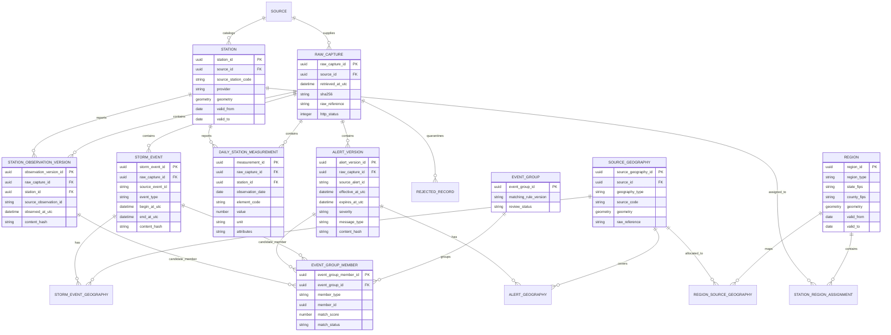

# Workshop 1 Conceptual ER Model

- **Status:** Accepted conceptual model for Workshop 1
- **Date:** 2026-11-05
- **Station/geography owner:** Pablo Garzon
- **Canonical integration owner:** Kevin Rincon
- **Implementation:** Workshop 2 migrations after field-level review

This model separates immutable raw captures, source-specific records,
analytical regions, and inferred event groups. It is conceptual: names and
cardinalities guide the first SQL design but do not claim implemented tables.

## Modeling rules

- `RAW_CAPTURE` is immutable and content-addressed; normalized rows retain its
  reference.
- Source identities and content versions are separate so same-ID revisions are
  auditable.
- `REGION` stores Oklahoma counties; source zones/polygons remain in
  `SOURCE_GEOGRAPHY` with many-to-many allocation.
- Daily GHCN dates remain dates. NWS/Storm Events instants are normalized to UTC
  while original time fields remain in raw evidence.
- `EVENT_GROUP_MEMBER` is an inferred relationship with a rule version and
  review status. Candidate pairs never become confirmed merely because they
  share time/geography.
- Invalid records retain raw provenance and a rejection reason.

## Open SQL-level decisions

- Exact PostgreSQL/PostGIS types, indexes and constraints.
- Hazard-specific domain tables and severity/value representation.
- Polymorphic event-group membership implementation versus separate link
  tables.
- Boundary/crosswalk data source and versioning mechanism.
- Final uniqueness constraints after multi-year duplicate profiling.
