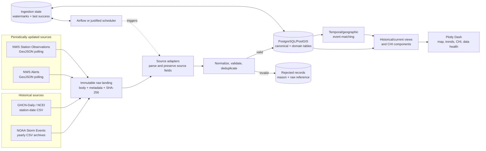

# Workshop 1 Architecture Overview

- **Status:** accepted high-level Workshop 1 proposal
- **Implementation:** Workshops 2-4

The professor's reference architecture is adapted to four weather sources while
keeping historical and incremental extraction separate. Boxes describe planned
responsibilities; they do not claim implemented services.

## Workshop boundaries

- **Workshop 1:** validate sources, preserve samples, define contracts, mapping and this architecture.
- **Workshop 2:** implement Docker, raw landing, database, historical adapters, validation and quarantine.
- **Workshop 3:** implement incremental polling, watermarks, retries, scheduling and event matching.
- **Workshop 4:** implement analytical views, historical/current comparison, CHI and dashboard.

The conceptual entity relationships are detailed in
`docs/architecture/workshop-1-er-model.md` and the field mapping is maintained in
`workshop_1/mapping.md`.
